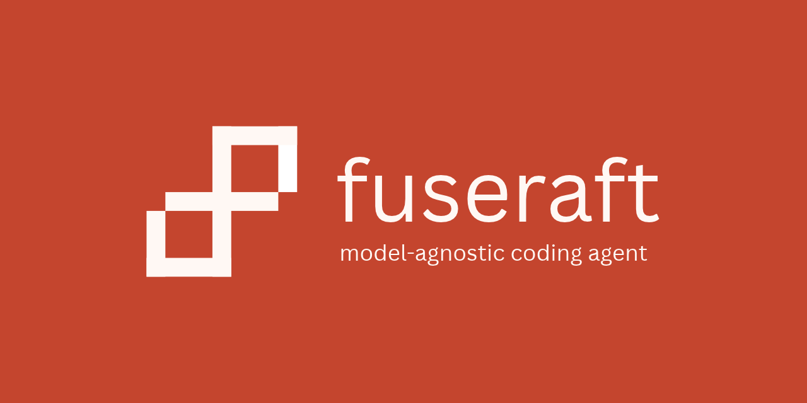
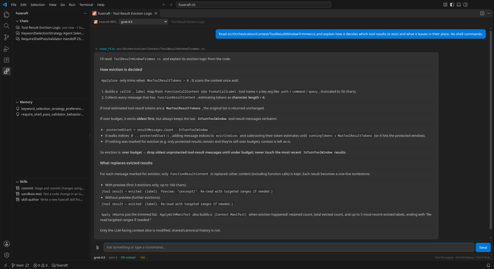

# fuseraft for VS Code



Chat with a [fuseraft](https://github.com/fuseraft/fuseraft-cli) agent in a panel beside your editor. It reads and edits your code, runs commands with your approval, and remembers what it learns across chats.

[Docs](https://fuseraft.ai/fuseraft-cli/) · [GitHub](https://github.com/fuseraft/fuseraft-cli)



## Getting started

1. **Install this extension.**
2. **Install the fuseraft CLI.** The extension runs on it. If it isn't on your `PATH`, a notification offers to install it: **Install** runs the official installer in a terminal (`curl … | bash` on Linux and macOS, PowerShell on Windows), then **Check again** picks it up. If it's installed somewhere else, use **Set Binary Path**.
3. **Pick a provider.** Once the CLI is found, the setup wizard opens. Choose a provider (Anthropic, OpenAI, xAI, Google, Mistral, DeepSeek, Ollama, or a custom endpoint), enter your API key, pick a model, and **Test** the connection. **Save** stores the key in your OS keychain, not in a file. Run **fuseraft: Configure fuseraft** to change any of it later.
4. **Start chatting.** Click **fuseraft** in the status bar, or **+** in the Chats view of the fuseraft sidebar.

## The chat panel

It works like the CLI's full-screen REPL.

**Following a turn**
- The model's thinking streams in dimmed under `∴` and folds to one line when it moves on.
- Each tool call is a line that turns ✓ or ✗ when its result comes back; a sub-agent's calls are nested under it. Changed files show as `✎ path +added -removed`, and clicking one opens it.
- Click a tool line for its arguments and output, or press **Ctrl+O** to page through recent tool output, thinking and shell output in full.
- The status line shows the model, the turn, how full the context is (yellow as auto-compaction nears), active modes such as `hitl`, and a timer.

**Talking to it**
- Type while it works: a message joins the running turn after its current tool calls. `/title` and `/hitl on|off` apply at once; other `/commands`, `!commands` and `$skills` wait as a chip until the turn ends.
- Completions for `/commands`, `$skills` and `@paths`. An `@path` attaches the file (git-ignored files and `.env` aren't offered).
- Paste a screenshot, or attach images with the paperclip.
- **↑/↓** walk your history, **Ctrl+R** searches it.
- `!git status` runs a command yourself: unsandboxed, streamed into the panel, never shown to the model.
- Switch models from the header without losing the conversation.

**Staying in control**
- With HITL on (the default), shell commands, file writes and other changes ask first, above the prompt; file writes open a real diff. Answer with **y**/**n**, or Esc to deny.
- **Stop** or **Ctrl+C** interrupts a turn; press again to kill commands it's stuck on.
- You get a notification when a reply finishes or an approval or question is waiting while you're elsewhere.

**Keys:** **Enter** sends, **Shift+Enter** or **Alt+Enter** adds a line, **PgUp/PgDn** scroll, **Ctrl+End** follows new output again, **Ctrl+F** searches the conversation, **F2** renames the chat. `/copy` puts the last reply on the clipboard.

## The sidebar

**Chats:** your chats in this workspace, newest first. Click one to resume it; its last few turns are replayed. Each chat is named from its first prompt and reply once the reply arrives (`fuseraft settings set repl.autoTitle false` turns that off). Rename one with **F2**, the right-click menu, or `/title <name>` in the chat; an empty name goes back to the generated one.

**Memory:** what the agent has remembered from your chats, grouped by type. Click an entry to open it; right-click to delete one or all.

**Skills:** reusable instructions the agent can load when it needs them. Click one to open its `SKILL.md`; **+** adds one, right-click removes it.

Chats, memories and skills live in the fuseraft home directory, `~/.fuseraft` by default.

## Commands

| Command | Description |
|---------|-------------|
| `fuseraft: Open REPL` | Show the open chat, or start one |
| `fuseraft: New Chat` | Start a fresh chat (the current one stays resumable) |
| `fuseraft: Resume Chat` | Pick any saved chat and resume it |
| `fuseraft: Refresh Chats` / `Refresh Memory` / `Refresh Skills` | Reload a sidebar view |
| `fuseraft: Delete Memory` / `Delete All Memories` | Delete one memory entry, or all of them |
| `fuseraft: Add Skill` / `Remove Skill` | Add or remove a skill |
| `fuseraft: Configure fuseraft` | Change your provider, model or API key |
| `fuseraft: Install CLI` / `Update CLI` | Install the CLI, or update it to the latest release, in a terminal |
| `fuseraft: Set Binary Path` | Point at a fuseraft binary that isn't on your `PATH` |
| `fuseraft: Set Home Directory` | Use a fuseraft home other than `~/.fuseraft` |

Rename Chat and Delete Chat are on a chat's right-click menu. Multi-agent orchestration (`fuseraft run`) lives in the CLI; run it from a terminal.

## Settings

| Setting | Default | Description |
|---------|---------|-------------|
| `fuseraft.binaryPath` | `fuseraft` | Path to the fuseraft binary |
| `fuseraft.homeDir` | _(blank)_ | fuseraft home directory (`~/.fuseraft` when blank); same as the CLI's `FUSERAFT_HOME` |
| `fuseraft.notifications` | `true` | Notify when a reply finishes, or an approval or question waits, while you're away from the panel |

## Requirements

- VS Code 1.85 or later
- The fuseraft CLI (the extension can install it). Use a current release: an older CLI still works, but the panel shows less (no thinking, tool lines, status line, mid-turn messages or generated titles).

## Development

```bash
npm install && npm run compile
```

Press `F5` to launch an Extension Development Host. To package: `npx vsce package`.

## License

MIT
