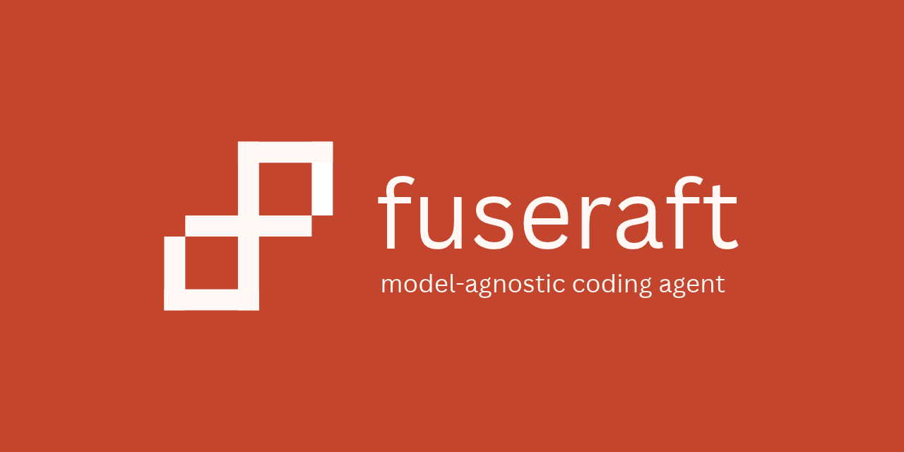
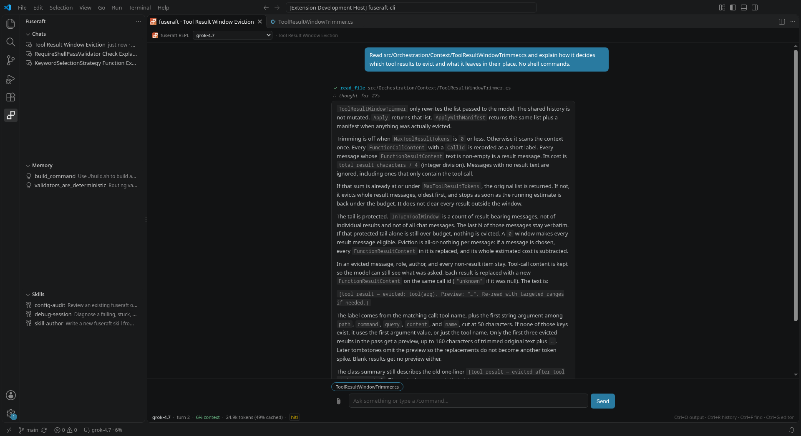

# fuseraft for VS Code



An open-source coding agent for VS Code that works with any model, built on [fuseraft](https://github.com/fuseraft/fuseraft-cli). It reads and edits your code, runs commands with your approval, and remembers what it learns across chats.

[Docs](https://fuseraft.ai/fuseraft-cli/) · [GitHub](https://github.com/fuseraft/fuseraft-cli)



## Getting started

1. **Install this extension.**
2. **Install the fuseraft CLI.** The extension runs on it. If it isn't on your `PATH`, a notification offers to install it: **Install** runs the official installer in a terminal (`curl … | bash` on Linux and macOS, PowerShell on Windows), then **Check again** picks it up. If it's installed somewhere else, use **Set Binary Path**.
3. **Pick a provider.** Once the CLI is found, the setup wizard opens. Choose a provider (Anthropic, OpenAI, xAI, Google, Mistral, DeepSeek, Ollama, or a custom endpoint), enter your API key, pick a model, and **Test** the connection. **Save** stores the key in your OS keychain, not in a file. Run **fuseraft: Configure fuseraft** to change any of it later.
4. **Start chatting.** Click **fuseraft** in the status bar, or **+** in the Chats view of the fuseraft sidebar.

## The chat panel

It works like the CLI's full-screen REPL.

**Following a turn**
- The model's thinking streams in dimmed under `∴` and folds to one line when it moves on.
- Each tool call is a line that counts up while it runs and turns ✓ or ✗ with how long it took; a sub-agent's calls are nested under it. Changed files show as `✎ path +added -removed`, and clicking one opens it.
- Click a tool line for its arguments and output, or press **Ctrl+O** to page through recent tool output, thinking and shell output in full.
- The status line shows the model, the turn, how full the context is (yellow as auto-compaction nears), the tokens the session has used and how many came from the provider's cache, active modes such as `hitl`, and a timer.

**Starting a chat**
- A new chat offers places to start from what's open: explaining the file you're in, reviewing your uncommitted changes, or continuing your last chat in this workspace. Clicking one fills in the prompt for you to edit; **Continue** resumes that chat in the same panel.
- Below them, a line shows where the agent may work (the folder it's sandboxed to, or a warning when `repl.yolo` turns the sandbox off).

**Working with your code**
- Select code and press **Ctrl+Shift+Alt+A** (**Cmd+Shift+Alt+A** on macOS), or right-click and choose **fuseraft: Add to Chat**. The selected code goes into your message, so the agent doesn't have to read the file. With nothing selected, the whole file is attached.
- Right-click files or folders in the Explorer, or an editor tab, and choose **fuseraft: Add File to Chat**. You can also hold **Shift** and drop them on the panel.
- The file you're working in shows as a chip above the prompt and is named with each message, along with any lines you've selected, so you can ask about "this function" without attaching anything. Click the chip to turn this off or on.
- File paths in replies, like `src/app.ts:42`, are links that open the file at that line.
- Code blocks in replies can be inserted at your cursor (replacing the selection), opened in a new editor, or copied.
- **Ctrl+Shift+Alt+F** (**Cmd+Shift+Alt+F**) opens the chat. Press it in the chat to go back to your file.
- A chat that's open when VS Code closes or reloads is resumed when it comes back.

**Talking to it**
- Type while it works: a message joins the running turn after its current tool calls. `/title` and `/hitl on|off` apply at once; other `/commands`, `!commands` and `$skills` wait as a chip until the turn ends. **↑** on an empty prompt takes the last one back to edit, and stopping the turn drops them.
- Completions for `/commands`, `$skills` and `@paths`. An `@path` attaches the file (git-ignored files and `.env` aren't offered).
- Paste a screenshot, or attach images with the paperclip. A paste longer than 10 lines or 2,000 characters shows as `[pasted #1 · 40 lines]` and is sent in full (Ctrl+O shows it).
- **↑/↓** walk your history, **Ctrl+R** searches it.
- **Ctrl+G** opens the draft in an editor tab beside the panel; each save puts it back in the prompt.
- `!git status` runs a command yourself: unsandboxed, streamed into the panel, never shown to the model.
- Switch models from the header without losing the conversation.

**Staying in control**
- With HITL on (the default), shell commands, file writes and other changes ask first, above the prompt; file writes open a real diff. Answer with **y**/**n**, or Esc to deny.
- **Stop** or **Ctrl+C** interrupts a turn; press again to kill commands it's stuck on.
- You get a notification when a reply finishes or an approval or question is waiting while you're elsewhere.

**Keys:** **Enter** sends, **Shift+Enter** or **Alt+Enter** adds a line, **PgUp/PgDn** scroll, **Alt+↑/↓** jump between the messages you sent, **Ctrl+End** follows new output again, **Ctrl+F** searches the conversation, **F2** renames the chat. `/copy` puts the last reply on the clipboard.

## The sidebar

**Chats:** your chats in this workspace, newest first. Click one to resume it; its last few turns are replayed. Each chat is named from its first prompt and reply once the reply arrives (`fuseraft settings set repl.autoTitle false` turns that off). Rename one with **F2**, the right-click menu, or `/title <name>` in the chat; an empty name goes back to the generated one.

**Memory:** what the agent has remembered from your chats, grouped by type. Click an entry to open it; right-click to delete one or all.

**Skills:** reusable instructions the agent can load when it needs them. Click one to open its `SKILL.md`; **+** adds one, right-click removes it.

Chats, memories and skills live in the fuseraft home directory, `~/.fuseraft` by default.

## Commands

| Command | Description |
|---------|-------------|
| `fuseraft: Open REPL` | Show the open chat, or start one |
| `fuseraft: New Chat` | Start a fresh chat (the current one stays resumable) |
| `fuseraft: Resume Chat` | Pick any saved chat and resume it |
| `fuseraft: Add to Chat` | Add the editor's selection (or its file) to the message you're writing |
| `fuseraft: Refresh Chats` / `Refresh Memory` / `Refresh Skills` | Reload a sidebar view |
| `fuseraft: Delete Memory` / `Delete All Memories` | Delete one memory entry, or all of them |
| `fuseraft: Add Skill` / `Remove Skill` | Add or remove a skill |
| `fuseraft: Configure fuseraft` | Change your provider, model or API key |
| `fuseraft: Install CLI` / `Update CLI` | Install the CLI, or update it to the latest release, in a terminal |
| `fuseraft: Set Binary Path` | Point at a fuseraft binary that isn't on your `PATH` |
| `fuseraft: Set Home Directory` | Use a fuseraft home other than `~/.fuseraft` |

Rename Chat and Delete Chat are on a chat's right-click menu. Multi-agent orchestration (`fuseraft run`) lives in the CLI; run it from a terminal.

## Settings

| Setting | Default | Description |
|---------|---------|-------------|
| `fuseraft.binaryPath` | `fuseraft` | Path to the fuseraft binary |
| `fuseraft.homeDir` | _(blank)_ | fuseraft home directory (`~/.fuseraft` when blank); same as the CLI's `FUSERAFT_HOME` |
| `fuseraft.notifications` | `true` | Notify when a reply finishes, or an approval or question waits, while you're away from the panel |
| `fuseraft.includeActiveFile` | `true` | Name the file you're working in (and your selected lines) with each message |

## Requirements

- VS Code 1.85 or later
- The fuseraft CLI (the extension can install it). Use a current release: an older CLI still works, but the panel shows less (no thinking, tool lines, status line, mid-turn messages or generated titles).

## Development

```bash
npm install && npm run compile
```

Press `F5` to launch an Extension Development Host. To package: `npx vsce package`.

## License

MIT
